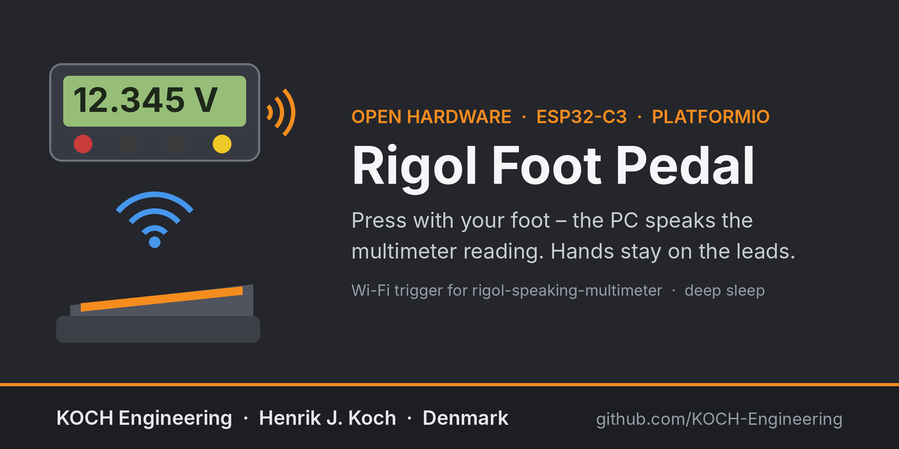

# Rigol Speaking Multimeter - ESP32-C3 Foot Pedal

A Wi-Fi foot pedal trigger for [rigol-speaking-multimeter](../rigol-speaking-multimeter):
press it, and the PC running that app speaks the current multimeter
reading - same effect as pressing F8, but hands-free, for when both hands
are busy with test leads.

## Hardware

- An **ESP32-C3 "Super Mini"** board (or any ESP32-C3 board - pin numbers
  may need adjusting for a different board's silkscreen/layout).
- A normally-open momentary foot switch/pedal, wired between **GPIO4** and
  a nearby **GND** pad.
- Two optional external LEDs (each with its own current-limiting resistor,
  a few hundred ohms, to GND) - see the pinout table below. Neither is
  required; leave a pin unconnected and the firmware just drives an LED
  that isn't physically there.

### GPIO pinout

| GPIO | Name | Purpose |
|------|------|---------|
| **GPIO4** | `BUTTON_PIN` | Foot pedal switch, other side to GND. Internal pull-up - no external resistor needed. Also the deep-sleep wake source. |
| **GPIO8** | `LED_PIN` | Onboard blue status LED (built into most ESP32-C3 dev boards - not a pin you wire yourself). Blinks at boot, solid on once Wi-Fi is up, blinks off/on briefly on each press, off before sleep. |
| **GPIO6** | `EXT_STATUS_LED_PIN` *(optional)* | External LED mirroring GPIO8's exact state, so the same status is visible from outside the pedal's enclosure instead of only on the tiny onboard LED. |
| **GPIO5** | `ACK_LED_PIN` *(optional)* | External LED that blinks briefly the moment the PC app acknowledges receiving a trigger - see "PC acknowledgement" below. |

No external resistor needed for the button - the firmware enables the
chip's own built-in pull-up on GPIO4, both via `pinMode` for normal
operation and, right before sleeping, again via the IDF GPIO driver
(`gpio_pullup_en`) to make sure it's actually held through deep sleep,
since `pinMode`'s setting isn't guaranteed to survive that. (An earlier
draft used `rtc_gpio_pullup_en`, which is the right call on the original
ESP32 but doesn't exist on the ESP32-C3's simpler GPIO/RTC architecture -
confirmed by an actual build error, fixed to the plain
`gpio_pullup_en`/`gpio_pulldown_dis`.)

GPIO4 was chosen deliberately: it's RTC-capable, isn't one of the three
strapping pins, and - confirmed against real-world ESP32-C3 deep-sleep
reports - GPIO0/GPIO1 are RTC-capable too but do *not* reliably work as
wake sources on this chip (a known Arduino-ESP32 core limitation); only
GPIO2-5 do. GPIO5 and GPIO6 were chosen for the two optional LEDs as
plain general-purpose pins - not strapping pins, not used for flash/USB -
so they're safe to drive freely; rewire `ACK_LED_PIN`/`EXT_STATUS_LED_PIN`
in `src/main.cpp` if either is inconvenient on your own board's layout.
Each LED's active-high/active-low polarity is its own separate `#define`
(`ACK_LED_ACTIVE_LOW`, `EXT_STATUS_LED_ACTIVE_LOW`) - flip whichever one
lights up backwards from how you wired it.

## Building and flashing

Requires [PlatformIO](https://platformio.org/) (the CLI, or the VS Code
extension). From this folder:

```
pio run --target upload
```

Then, to watch its serial output while testing:

```
pio device monitor
```

Note: this board almost certainly uses the ESP32-C3's built-in native USB
(not a separate USB-UART bridge chip), so every reset - including waking
from deep sleep - makes the USB connection itself drop and re-enumerate.
The very first boot log lines are often lost in that brief gap before
Windows/the monitor notice the port came back. Don't worry if you miss
them; the firmware repeats an "awake, IP=..., sleeping in Ns" line every
2 seconds for as long as it stays awake, so you'll catch that even if you
missed the initial boot messages.

**Confirmed working end-to-end on real hardware** (an "ESP32-C3 Super
Mini" board): deep sleep, GPIO4 wake, Wi-Fi setup portal, subnet-broadcast
UDP trigger, and a real pedal press making
[rigol-speaking-multimeter](../rigol-speaking-multimeter) speak on the PC.
The one non-obvious extra step it took to get there: Windows Firewall was
silently dropping the incoming UDP packet on the PC side, even though the
pedal itself was sending it correctly - see that project's README for how
the PC app now handles this mostly automatically.

## First-time setup

1. Power on the pedal. It creates its own temporary Wi-Fi network called
   **"RigolPedal-Setup"** (setup page styled with yellow buttons/black
   text).
2. Connect to that network from your phone or laptop. A setup page should
   open automatically; if not, browse to `192.168.4.1`.
3. Pick your real Wi-Fi network and enter its password.
4. Check **Trigger UDP port** — pre-filled with `47269`, matching the
   Python app's own default `--trigger-port`; leave it alone unless you
   changed that on the PC side.
5. Save. The pedal reboots and joins your real network.

There's no PC IP address to enter: the pedal broadcasts its trigger to the
whole local network rather than addressing one specific PC, so nothing
needs re-entering if the PC's DHCP-assigned IP ever changes.

To redo this later (new Wi-Fi network, changed trigger port), hold the
**foot pedal itself** down for 10+ seconds right as it wakes, instead of a
quick tap. The hold time is deliberately long so that leaning on the pedal
or a stuck switch during normal use won't accidentally wipe the saved Wi-Fi.
(Not the onboard BOOT button — that's a boot-mode strapping pin
on the ESP32-C3, and holding it down during power-on/reset sends the chip
into its serial bootloader instead of running the firmware at all, which
is why an earlier version of these instructions didn't work.)

## How it behaves

- Spends almost all its time in deep sleep (very low power).
- A pedal press wakes it, it joins Wi-Fi, and broadcasts the trigger packet
  to the local network on the configured port.
- It then stays awake for a configurable stay-awake window (5 minutes by
  default), resetting that countdown on every further press, so a burst of
  presses during one probing session doesn't pay the Wi-Fi-reconnect cost
  each time.
- After that window passes with no press, it goes back to deep sleep.
- The onboard blue LED (**GPIO8**, mirrored on the optional external
  **GPIO6** LED) blinks a few times at boot (proof the firmware is
  actually running, independent of Wi-Fi), turns solid on once connected
  to Wi-Fi ("link up"), blinks off for 200ms and back on each time the
  pedal is pressed while awake, and turns off before going to deep sleep -
  confirmed working as described. If either LED ever behaves backwards on
  a different board (on when it should be off, etc.), flip
  `LED_ACTIVE_LOW` / `EXT_STATUS_LED_ACTIVE_LOW` in `src/main.cpp`.
- The optional **GPIO5** ack LED blinks separately, once per trigger, the
  moment the PC app actually confirms it received that trigger - see
  "PC acknowledgement" below.

## Live status page (while awake)

While the pedal is awake — right after a press, during that stay-awake
window — it runs a small web page at its normal network IP (check your
router's connected-devices list, or `pio device monitor`). It shows the
pedal's IP/Wi-Fi network, time since the last trigger, seconds left before
it sleeps, and a **live pedal input indicator** (PRESSED/RELEASED,
updating a few times a second) so you can watch the raw switch state
change as you press/release it — handy for checking wiring and contact
bounce without a multimeter — plus:

- A **Send test trigger now** button, to confirm the PC app is receiving
  triggers without needing to walk over and press the pedal. Fires via a
  background request (no page navigation), so it updates in place exactly
  like a real pedal press - it used to be a plain HTML form submit, which
  reloaded the whole page and made every field flash back to its
  placeholder before the polls repopulated it.
- A settings form to change the **trigger UDP port** and the **stay-awake
  duration** (15–3600 seconds) — applied immediately and saved to flash,
  no reflash or Wi-Fi reconfiguration needed.
- A **PC acknowledged** line showing whether the app on the PC actually
  received the last trigger - "waiting for PC ack..." right after a press,
  "yes, 123 ms round-trip (press was 5 s ago)" once it's confirmed, or a
  warning if nothing's come back after a few seconds. The "press was ... ago"
  part matters once the page has been sitting open a while: a bare "yes
  (123ms)" looked like fresh news no matter how long ago the actual press
  was, since the round-trip time alone doesn't say when that happened. See
  "PC acknowledgement" below for how this works.

Loading the page or clicking either button also resets the sleep
countdown. This page only exists while the pedal is awake — once it goes
back to deep sleep it disappears from the network entirely until the next
press; there's no way to wake it remotely.

The **Last trigger** line ticks live off the same ~500ms poll that drives
the PC-acknowledged line, instead of freezing at whatever it said when the
page first loaded. The browser tab/taskbar entry reads "Rigol Pedal" (via
an explicit `<title>`) rather than falling back to showing the page's own
IP address.

## PC acknowledgement

Historically the pedal only ever *sent* UDP - one-way, no confirmation
that anything on the other end actually received it. As of firmware 1.5.0
it also listens: the moment `rigol_speaking_multimeter.py` receives a
trigger packet, it fires a one-byte reply straight back to the pedal
(before doing anything else, so this confirms delivery, not that the
meter necessarily produced a spoken reading afterwards - that part can
still take a moment longer). The pedal shows this two ways:

- The optional **ACK_LED_PIN** (GPIO5) LED blinks briefly the instant the
  reply arrives - independent of whether you've released the pedal yet,
  since round-trip timing has nothing to do with how long your foot stays
  down.
- The live status page's **PC acknowledged** line updates the same way,
  polled every ~500ms from a small `/trigger_ack` endpoint.

The status page reserves a fixed 2-line-tall box for this message,
displayed on its own line under the "PC acknowledged:" label (not run on
from the label itself), regardless of which state it's showing - the
shortest ("waiting for PC ack...") and longest ("no response yet (X.Xs) -
is the app running?") text would otherwise wrap differently, and even
wrap awkwardly right after the label's first word or two, making the
page's height and layout visibly jump around on its own every ~500ms as
this updates.

If neither ever fires, check that `rigol_speaking_multimeter.py` is
actually running and that Windows Firewall isn't blocking the port (same
troubleshooting as a trigger never arriving at all - see that project's
README).

## Fast recovery after waking up

Every response from the live status page's endpoints (`/`, `/pin`,
`/remaining`, `/trigger_ack`) sends `Connection: close` and
`Cache-Control: no-store`. Without this, a browser tab left open across a
deep-sleep cycle could end up reusing a now-dead keep-alive TCP connection
from before the pedal slept (the Wi-Fi radio just switches off during deep
sleep - there's no graceful close to tell the browser the link is gone), so
the page's polling could take a long time (tens of seconds or more) to
notice the pedal is back, rather than the ~1s its polling intervals are
designed around. Forcing a fresh connection on every single poll means a
truly-asleep pedal fails fast (nothing listening - instant refusal, not a
hang), and the moment it's back up and listening again, the very next poll
just works.

## Known limitations / possible follow-ups

- No RTC-memory Wi-Fi channel/BSSID caching yet, which could speed up
  reconnection after a long deep sleep - left out of this first version
  for simplicity.
- No physical low-battery indicator.
- The PC's ack (see above) confirms the app received the trigger, not
  that the meter reading was actually spoken successfully - a meter-side
  failure after that point wouldn't be reflected back to the pedal.
